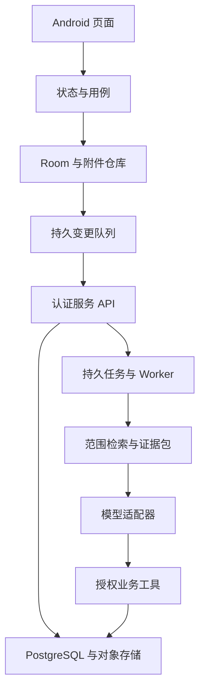

# 工程架构与技术选择

## 7. 技术架构与选型

### 7.1 推荐组合

| 领域 | 选择 | 理由与约束 |
| --- | --- | --- |
| 原生 UI | Kotlin + Jetpack Compose | 沿用你的方向，便于原生输入、手势、状态与生命周期处理 |
| 本地数据库 | Room / SQLite | 离线保存、迁移、事务和查询 |
| 状态 | ViewModel + StateFlow + 单向数据流 | 界面从统一状态渲染，事件可追踪 |
| 设置 | DataStore | 仅存偏好设置，不当笔记数据库 |
| 异步 | Kotlin Coroutines | IO、解析、索引和缩略图处理移出主线程 |
| 图片 | 维护中的原生图片加载库，例如 Coil | 缩略图、缓存、尺寸感知解码；锁定兼容版本 |
| 后台备份 | WorkManager | 适合可延后的可靠工作，不承诺准点提醒 |
| 指定时刻提醒 | AlarmManager + 通知 | 检查权限、系统状态和重新调度 |
| 特效 | 自有 GlassSurface 组件，内部封装 Haze 等候选实现 | 避免业务页面绑定某套实验 API |
| 性能验证 | Macrobenchmark、Baseline Profiles、Perfetto | 使用 release 构建在真机验证 |

新项目可从 minSdk 26 评估起步；已有项目尊重原兼容范围，不为了玻璃效果直接抬高最低版本。targetSdk 和依赖版本在开发时按发布渠道与兼容验证确定，本文不把所有“最新版本”硬塞进项目。

Compose 能实现这一方向，但框架选择本身不能保证流畅。官方也要求通过 release 构建、合理状态处理和性能测量验证。[S2](../research/sources.md)

### 7.2 模块边界

早期可以放在单个 app 模块，以包隔离职责：ui/designsystem、feature/capture、feature/editor、feature/library、feature/tasks、feature/review、feature/walk、feature/insight、feature/agent、feature/map、data/local、data/backup、core/model。

依赖方向保持简单：界面 → ViewModel → Repository → 数据库/附件仓库。文件导入、备份恢复、提醒调度作为独立服务边界。业务规模确实增长后再拆 Gradle 模块，避免小项目一开始维护大量构建配置。

列表只观察摘要数据；编辑器只观察当前笔记；自动保存一个字不能让整个首页重组。列表使用稳定 ID，图片容器预留尺寸，避免滚动时跳动。

### 7.3 液态玻璃的实现策略

特别注意：Compose 的 Modifier.blur 模糊的是组件自身绘制的内容。直接把它套到带文字的导航上，会把文字也模糊。背景玻璃需要背景采样、效果处理、前景清晰绘制的分层。[S1](../research/sources.md)

Haze 是可评估的背景模糊和玻璃效果库。作者在 2026-11-02 发布的 2.1 公告中称 Glass API 已稳定，同时仍把原生 Android backdrop 后端和 input sharing 标为实验能力。不能据此承诺所有安卓设备都能承受同等效果，也不要把实验后端作为首版必需项。[S10](../research/sources.md)

实施顺序：

1. 做一个只含长列表、底部玻璃导航、输入面板的性能样例。
2. 比较纯色基线、背景模糊、加入折射后的帧耗时和内存。
3. 把选定实现封装进 GlassSurface，业务仅传材质等级、形状和状态。
4. 标准档保留模糊、染色和边缘高光；增强档增加轻微折射；简化档用清晰实底、渐变和阴影保持风格。
5. 按 API 能力与实测配置选择默认档。运行中因低电量或持续异常降档要有滞后，避免滚动时画质反复跳变。
6. 完成键盘、弹层、滚动、旋转和截图测试，再将样例组件接入实际页面。

普通 Modifier.blur 的平台支持从 Android 12 起；第三方库能否在更老系统回退，要核对其实际文档与测试结果，不能把一个 API 的限制直接套到所有库。[S1](../research/sources.md)

### 7.4 编辑器与存储模型

新项目建议采用小型、带版本的文档模型：一个 Note 拥有一份 document_json，里面是平面块列表；每块有稳定 block_id，可表示段落、标题、列表、勾选项和图片引用。首期不要做无限嵌套、拖动块和跨块复杂排版。

文本输入使用原生输入组件。编辑期间保留输入法 composing 区、选区和撤销状态，不要每次输入都序列化再解析回 UI。序列化在合适的后台任务中进行，按 revision 写入。

如果已有项目使用 Markdown 或其他稳定格式，先沿用并增加适配层；迁移格式必须单独立项、可验证恢复。此处的新项目模型不构成重写已有库的理由。

| 数据对象 | 核心字段与规则 |
| --- | --- |
| Note | UUID、author_type、source_type、source_url、ai_scope、可选标题、document_json、document_version、search_text、notebook_id、created_at、updated_at、revision、archived_at、deleted_at |
| Tag / NoteTag | tag_id、parent_id、展示路径与多对多关系；移动防循环 |
| Attachment | UUID、相对路径、媒体类型、大小、校验值、导入状态 |
| Draft | draft_id、目标 note_id 或空、文档、revision、保存时间 |
| TaskIndex | note_id + block_id、展示文字、完成状态、日期；是可重建索引 |
| Reminder | 对应 note_id + block_id、计划时刻、时区、调度状态 |
| NoteLink | source_id、target_id、block_id、关系类型；支撑引用、反链与关系图 |
| BackupManifest | 格式版本、条目数、附件校验值、生成时间 |

文档是待办内容与完成状态的唯一权威来源。TaskIndex 是查询加速层，勾选待办必须在同一事务中修改文档和索引；任务页不能另存一份永远不会同步的文本。

### 7.5 共享检索与推理架构

统一链路：本地提交 → 持久化变更事件 → 规范化/切片 → 更新关键词索引与嵌入 → 查询召回 → 重排与去重 → 权限复核 → 构造证据包 → AI 生成 → 保存结果与来源。

短笔记尽量作为完整语义单位；长文按段落和标题切片，每片保留 note_id、revision、chunk_id 与字符范围。检索后按原文合并相邻片段，不能失去上下文。

关键词与向量检索各有用途，组合使用并单独评估。选定 embedding 模型前用真实中文、口语、短句和中英混合样本验证；模型版本与维度必须写入索引元数据。更换模型时重建隔离索引，完成后再切换，不能混用不同向量空间。

相关笔记、找一找、漫步、地图与 Agent 共享索引设施，各自拥有不同的排序目标。相似度最高不总是最适合漫步；搜索需要精确，漫步需要适度多样，地图需要全局可解释性。

每个 EvidenceBundle 记录实际读取的笔记版本、片段、范围、截断情况与来源类型。生成器只能引用存在于该证据包的 ID。引用存在性可自动校验，语义是否真正支持结论仍需用人工标注样本评估。

新笔记提交后先进入关键词搜索，嵌入可异步补齐。UI 显示语义索引进度，不能让旧索引看起来代表最新全库。更改范围或删除笔记后优先执行失效与权限过滤。

### 7.6 Agent 与任务服务

模型适配器负责服务接口，业务工具负责实际动作，调度器负责长任务。模型不能直接拿数据库凭据或绕过业务层执行任意 SQL。

AgentRun 保存状态、范围、工具预算、实际用量、产生的结果与引用。流式断线支持按 run_id 继续读取；恢复时不会重新执行已提交的写入动作。

任务队列使用可重试但幂等的处理方式。每个步骤有超时、取消标记与结果检查；外部模型调用在返回前后检查任务是否仍有效。用户撤回授权后停止后续读取，正在执行的外部请求能否中止以供应商能力为准，并如实记录。

整库总结采用明确范围下的分组摘要与原文回查，报告实际覆盖笔记数。只取几个相似片段无法回答“我这一年所有变化”，这种问题要走聚合任务。

### 7.7 新增数据对象

| 对象 | 必要字段与规则 |
| --- | --- |
| NoteVersion | note_id、revision、文档快照、附件引用、编辑来源、时间 |
| NoteChunk / Embedding | 版本、切片范围、模型 ID/版本、维度、索引状态 |
| ReviewSession / ReviewEvent | 日期、范围快照、固定卡组、已看和排除反馈 |
| WalkSession / WalkStep | 起点、访问顺序、策略版本、分支、笔记版本 |
| EvidenceBundle | 范围、实际引用版本、抽样/截断说明、内容校验值 |
| Insight | 原问题、视角版本、证据包、生成状态、结果、用户反馈 |
| Conversation / Message | 会话范围、角色、内容、引用、来源入口 |
| AgentRun / ToolAction | run_id、action_id、授权快照、执行状态、幂等结果 |
| MemoryItem / MemorySource | 记忆文本、事实或推测、有效时间、来源、用户更正、状态 |
| ScheduledJob / JobRun | 周期、时区、下次执行、预算、授权、运行记录 |
| TopicCluster / MapSnapshot | 范围、索引版本、聚类版本、布局、覆盖率、更新时间 |
| IntegrationGrant / AuditEvent | 外部应用、工具权限、资料范围、过期/撤销与操作记录 |
| UsageLedger | 服务商、模型、输入输出与嵌入用量、语音时长、估算费用 |
| SyncOperation / Tombstone | 变更 ID、设备、版本、确认游标、删除状态 |

这些是逻辑对象，不要求每个都立即拆成独立服务。笔记权威存储与派生索引分开，索引损坏可以重建；无法重建的用户批注、路径和授权记录需要备份。

## 当前决策

本仓库为新项目，从原生 Android 开始；不默认存在 IdeaMemo 代码。既有方案提到的旧项目兼容要求仅在日后正式决定迁移时生效。

Android 采用 Kotlin、Compose、ViewModel/StateFlow、Room、Coroutines、DataStore。网络层采用 OkHttp + Retrofit（服务 API）与明确可取消的 SSE 客户端；序列化使用 kotlinx.serialization。图片采用 Coil。依赖注入初期采用显式构造/应用容器，依赖规模增长再评估 Hilt，避免为几十个类提前引入复杂构建。

服务端采用 Python + FastAPI，PostgreSQL 保存权威同步数据、任务、幂等记录与审计，pgvector 保存向量索引，S3 兼容存储保存附件。队列初期采用 PostgreSQL 持久化任务表 + 独立 worker 进程 + 租约，无需同时维护 Redis。业务增长再依据指标拆分。服务端不部署在本轮文档交付中。

这项选型便于 AI 检索与数据处理，代价是 Kotlin/Python 双语言契约一致性，使用版本化 JSON/API fixtures 约束。不得依赖客户端 SDK 隐式行为作为服务端协议。

## 系统边界

UI 不直接读模型供应商响应作为业务对象；所有工具写入经同一数据服务。模型无法获得数据库账号、用户 token 或对象存储管理凭证。

## 运行模式

| 能力 | 本地模式 | 连接服务模式 |
| --- | --- | --- |
| 记录/编辑/标签/本地搜索/导出 | 完整 | 完整 |
| 本地回顾和已缓存漫步 | 可用 | 可用并跨设备同步 |
| 语义相关/洞察/Agent | 需显式配置已支持的模型服务；离线显示可用缓存 | 服务端受范围控制执行 |
| 全天候定时 AI | 不承诺；前台运行或延后提示 | worker 按计划运行，仍报告延迟和失败 |
| 跨设备同步 | 无 | 增量同步与冲突处理 |
| 远程 MCP | 无公网服务 | 受控服务端入口 |

本地 BYOK 模式若实现，与云端模式使用同一 ToolService 抽象，在手机本地查询/执行，再把授权片段发送模型；禁止默默将整库传给供应商。该模式不提供手机休眠时的准点 AI 执行保证。

## 目录与依赖

M0 建立 `android/`、`server/`、`contracts/`、`tools/` 四个边界。Android 初期 `:app` + `:benchmark` 两个 Gradle 模块，功能按包隔离；只有构建性能/所有权需要时拆新模块。server 使用 domain、api、repositories、workers、providers、tests 分层，handler 不直接拼 SQL 或调用任意模型。

依赖方向：feature UI → use case → repository interface → local/remote adapter。设计系统只依赖 UI 基础库；功能不能互相导入具体 ViewModel。跨功能跳转使用导航协议和 ID。检索索引是可重建派生物，权威笔记修改不等待向量服务。

## 事务与异步边界

一次本地保存事务提交 Note、任务索引、引用更新与 Outbox；附件文件先完成暂存和校验，再在事务中建立引用。事务成功后 UI 显示本地保存，索引/同步/备份各自消费事件。生产者和消费者使用幂等 op_id，重试不产生重复实体。

客户端业务写入在 IO dispatcher 串行到单笔记 actor，跨笔记可有限并发。索引暂停/重建不能阻塞输入。大模型 token 批量聚合成块级 UI 更新；列表只观察摘要投影。所有后台任务受 lifecycle、取消与预算约束。

## 版本选择与构建复现

minSdk 初定 26。compileSdk/targetSdk 在 M0 按当时 Android 官方兼容要求和发布渠道核定；不在文档中猜最新 API 数字。M0 必须提交 JDK/Gradle/AGP/Kotlin/Compose BOM/Room/Coil/Haze 的兼容矩阵、官方依据、锁定版本、wrapper 校验与可复现构建。禁止 `+`、`latest.release` 和无上限依赖。

Haze 2.1 作为当前评估候选，内部 GlassSurface 隔离 API；实验 native backdrop/input-sharing 不作为首发依赖。M0 性能样例验证后才能变成生产批准依赖。[作者说明](https://chrisbanes.me/posts/haze-2.1.0/)

## 故障隔离与可观测性

记录 trace_id、run_id、op_id、错误码、耗时、重试数与用量。正文和问题原文不进默认日志。客户端提供用户可预览、脱敏的诊断导出。服务端检查 API、数据库、对象存储和 worker heartbeat；健康接口不能输出 secret。模型供应商故障只影响 AI 路径，核心数据 API 独立可用。

模型切换与费用策略通过版本化配置管理。数据库迁移优先 expand/contract：先加兼容字段和读写适配，确认旧客户端兼容后清理。API 至少保留当前和上一个已发布兼容版本；不兼容客户端先阻止云写入并允许本地导出，不强制清库升级。
