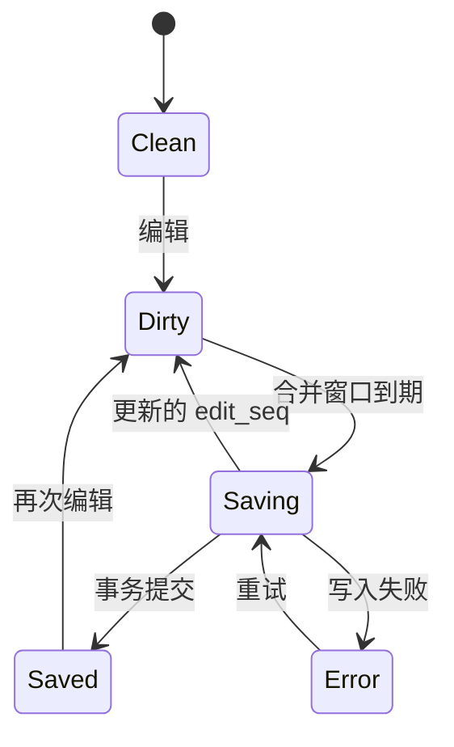

# 数据模型、状态与不变量

本文件是逻辑数据字典，M0/M1 将其转换为 Room schema 与 PostgreSQL migrations。UUID 使用随机 UUID v4；业务 ID 不暴露账户或时间信息。时间戳用 UTC ISO 8601，计划任务另存 IANA 时区与用户输入的本地时间。客户端修改顺序以 revision/op_id 判定，不用不可靠的设备时钟解决并发。

## D01：笔记文档

`Note`：id、owner_id（本地 profile 可为空服务端用户）、title?、document、document_schema_version、search_text、author_type、source_type、source_url?、notebook_id?、created_at、updated_at、local_revision、server_revision?、archived_at?、deleted_at?、ai_policy、content_hash。

author_type 为 user/ai/import；source_type 为 manual/voice/share/import/agent/insight/web。用户引用 AI 文本仍记录其来源，不能单凭最后编辑者把全部内容归为亲身经历。Note 的 AI 范围策略使用 inherit/allow/exclude；exclude 的优先级最高。

document 为平面 blocks 数组。每块 id 永久稳定；type 支持 paragraph、heading、bullet、numbered、checkbox、quote、image、audio、video、reference。文本 mark 使用 UTF-16 code unit 范围，便于 Android selection 对齐；存储前验证不得切断代理对，渲染按字素簇处理，后端不得按 Python 字符下标直接解释。范围为 [start, end)。表情/组合字符有专项测试。

checkbox 存 text、checked、due_date?、reminder_id?、occurrence_id?；重复规则归 Reminder 管理，task index 不再保存第二份权威正文。媒体块只存 attachment_id 与可选 caption。未知 block type 必须原样保留并以只读占位显示，不能被旧客户端保存时抹掉。

标题可空；空白无附件文档不创建新 Note。单条长度和附件上限通过配置及 UI 预检明确；初始测试覆盖 3 万字，超过验证范围给性能提示而非静默截断。

## D02：实体字典

| 实体 | 主键与核心字段 | 约束 / 删除行为 |
| --- | --- | --- |
| Draft | id, target_note_id?, document, edit_seq, committed_seq, updated_at | 同入口恢复同草稿；已提交后保留短暂撤销映射 |
| NoteVersion | note_id+revision, document, attachment_refs, origin, created_at | 不可变；恢复新建 revision；保留策略可见 |
| Tag | id, parent_id?, name, normalized_name, revision | 同父唯一；防循环；删除解除关联 |
| NoteTag | note_id+tag_id | 外键；删除笔记逻辑保留到清理 |
| Notebook | id, name, order, revision | 可选单一归属；删除转未分类 |
| NoteLink | id, source_id, source_block_id, target_id, target_revision?, kind | source block 删除使引用失效；反链为查询视图 |
| Attachment | id, owner, relative_path, hash_sha256, mime, bytes, width?, height?, duration?, state | 字节校验；引用计数包含版本/回收站/备份租约 |
| Transcript | id, attachment_id, raw_text, cleaned_text?, provider, locale, status, revision | 原始转写不可被整理版覆盖；用户修改另有 revision |
| TaskIndex | note_id+block_id, checked, due_date?, occurrence_id | 可重建；与文档同事务更新 |
| Reminder | id, note_id, block_id, zone, local_time, instant?, policy, status, revision | 任务删除取消调度；权限状态独立 |
| SavedSearch | id, name, scope_json, query, schema_version | 每次执行重新鉴权 |
| ChangeEvent/Outbox | op_id, entity_id, base_server_revision, payload, state, attempts, next_retry | 与业务事务同写；ACK 前不丢弃 |
| ReviewSession | id, profile, local_date, zone, scope_snapshot, note_ids, algorithm_version | 日期+profile+配置版本冲突可合并选择一个主会话 |
| ReviewEvent | id, session_id, note_id, type, occurred_at | 幂等；seen/defer/exclude 分开 |
| WalkSession | id, scope, start_note_id, seed, strategy_version, status | seed 辅助复现；实际路径为权威 |
| WalkStep | session_id+step_id, parent_step_id?, note_id, revision, branch, reason | 返回不抽签；分支不覆盖旧路径 |
| NoteChunk | id, note_id, revision, block_ids, start,end,text_hash | 版本改变失效；不得泄漏 excluded 内容 |
| Embedding | chunk_id+model_version, dimensions, vector, status | 模型空间严格隔离；可重建 |
| EvidenceBundle | id, scope, source_versions, coverage, truncation, created_at, grant_version | 不可变输入记录；删除来源时标记失效 |
| Perspective | id, title, prompt_template, version, user_defined | 视角版本进入报告 provenance |
| Insight | id, perspective_version, evidence_id, question, run_id, state, result, citations | 与 Note 分开；保存新笔记有显式行为 |
| Conversation | id, title, scope, memory_policy, created_at | 私有；删除影响消息/派生候选记忆 |
| Message | id, conversation_id, role, content, provenance, citations, run_id? | 工具返回与用户输入角色分明 |
| AgentRun | id, conversation_id, state, scope, budgets, auth_version, last_event_seq | 状态机持久化；终态不回到 running |
| ToolAction | id, run_id, tool, args_hash, idempotency_key, state, result_ref | 同 key 不同 args 返回冲突 |
| MemoryItem | id, text, kind, state, confidence_label, valid_from,to?, user_corrected | confidence 为解释标签，不能伪装概率测量 |
| MemorySource | memory_id+source_id, source_type, revision, excerpt_hash | 无来源不能默认作为事实采用 |
| ScheduledJob | id, spec_version, zone, local_rule, scope, tools, budget, next_run, enabled | 更改计划升版；恢复备份默认暂停 |
| JobRun | job_id+schedule_version+scheduled_instant, state, lease_until, result_ref | 唯一键阻止重复触发；lease 需 fencing token |
| MapSnapshot | id, scope, dataset_hash, index_version, cluster_version, layout_version, coverage | 快照不可变；过期可查看并标明 |
| TopicCluster | snapshot_id+cluster_id, label, note_ids, centroid, coordinates | 标签可编辑；机器重算保留映射 |
| IntegrationGrant | id, owner, client, tool_scopes, note_scope, expires_at, revoked_at, version | token 只存 hash；撤销优先于缓存 |
| AuditEvent | id, actor, tool, resource_ids, outcome, trace_id, occurred_at | 不含原文和密钥；用户可查看自己的记录 |
| UsageLedger | id, run_id, provider, model, units, price_version, estimate, actual? | 预留与结算分开；重试仍计实际成本 |
| Tombstone | entity_id, deleted_revision, deleted_at, ack_watermark, retention | 防止旧设备使已删除实体复活 |
| BackupManifest | version, created_at, entities, attachment_hashes, exclusions, checksum | 完整校验后切换；不同于同步 cursor |

## D03：NoteScope 统一语义

owner 从认证环境推导，不允许客户端任意设置。范围包含 created/updated 时间轴、fromInclusive/toExclusive、include_tag_ids、exclude_tag_ids、include_descendants、tag_match_mode(any/all)、notebook_ids、source_types、media_types、include_archived、include_deleted(false)、explicit_note_ids、ai_access。

所有非空维度取交集。include_tag_ids 内按 any/all；排除标签总是优先。空数组表示该维度不限制，只有 `untagged_only=true` 表示无标签，且与非空 include_tag_ids 冲突应报错。explicit_note_ids 只是进一步缩小范围，不能突破授权或排除条件。created_at 用于回顾；updated_at 仅在用户明确切换时使用。

标签子树在执行时解析；为长期证据记录执行时解析到的 tag IDs 与 scope revision。对话 scope 可以通过明确动作扩大，但不得超过账户授权范围。派生缓存键必须包含 owner、scope_hash、grant_version、index_version、query_hash。

## D04：保存状态机

saved 必须满足 committed_seq == 最新 edit_seq。异步返回旧 seq 时仅更新已提交水位，不把较新的 UI 标为保存完毕。不允许写入完成回调覆盖用户已输入的新内容。

## D05：索引与去重

精确检索在 Note 事务后快速更新；语义索引为 async。索引条目具有 note revision，一次查询后再检查实际当前权限/删除状态。最近编辑的内容可在语义索引尚旧时走关键词召回补足，但报告实际覆盖。

导入以 source package hash + external record id 建立导入映射；同一文件重复导入可跳过，正文相同但来源不同不强行认定重复。同步 op_id、API idempotency key、Note UUID 是不同层次标识，不能混为一个去重键。
